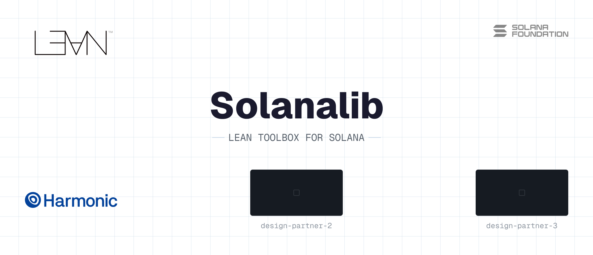

<div align="center">
  <picture>
    <source media="(prefers-color-scheme: dark)" srcset="https://github.com/solana-foundation/leanprover-solanalib/raw/main/docs/assets/banner-github-dark.png">
    <source media="(prefers-color-scheme: light)" srcset="https://github.com/solana-foundation/leanprover-solanalib/raw/main/docs/assets/banner-github-light.png">
    
  </picture>
</div>

<p align="center">
  <a href="https://github.com/solana-foundation/leanprover-solanalib/actions/workflows/ci.yml"></a>
  <a href="https://github.com/solana-foundation/leanprover-solanalib/actions/workflows/docs.yml"></a>
  <a href="LICENSE"></a>
</p>

**A [Lean 4](https://lean-lang.org/) library of formal models and verified theorems for Solana programs.** 

Status: **purely experimental — exploring framework shape.**

The ambition is to be for Solana what [Mathlib](https://leanprover-community.github.io/mathlib4_docs/) is for mathematics — a shared, well-documented foundation that downstream verification work can build on without redefining the same primitives every time. Programs written in [Anchor](https://www.anchor-lang.com/), [Pinocchio](https://github.com/anza-xyz/pinocchio), or hand-rolled, are intended to be modelled against `Solanalib`'s formal primitives and proven correct.

📚 **Generated docs:** <https://solana-foundation.github.io/leanprover-solanalib/>

---

## Why

Solana programs run with real assets at stake. Bugs in lending invariants, vesting curves, AMM math, PDA derivation, or token-supply accounting cost users — and code review is fundamentally limited as a defence: it scans for known patterns and misses what reviewers don't think to look for.

Formal verification flips the model. Instead of *reading* code looking for bugs, you *prove* the code matches a specification — a precise mathematical statement of intended behaviour. If the proof type-checks, the property holds *for every possible input*, not just the cases the reviewer happened to consider.

The bottleneck has historically been the cost of specs: writing them takes deep expertise, and every protocol has to reinvent the same primitives. `Solanalib` aims to lower that cost by providing the primitives — accounts, instructions, PDAs, common financial shapes — as reusable Lean definitions with theorems already proven about them.

The role this library plays in the stack:

```
┌──────────────────────────────────────────────────────────────┐
│  ON-CHAIN: Rust/Anchor/Pinocchio → compiled sBPF bytecode     │
└───────────────┬──────────────────────────────┬───────────────┘
                │ source-level                  │ artifact-level
┌───────────────▼──────────────────────────────▼───────────────┐
│  SPEC: Solanalib formal models in Lean 4                      │
│    · high-level layer  — accounts, instructions, finance …    │
│    · Solanalib.SBPF    — the sBPF ISA semantics: the machine  │
│                          the deployed bytecode actually runs  │
└──────────────────────────────────────────────────────────────┘
```

Solanalib lives entirely at the spec layer — it doesn't run on-chain. But it now models *both* ends of the refinement: the high-level shapes a protocol's logic is proven against, **and** the sBPF instruction-set semantics those programs compile down to. That lower anchor (`Solanalib.SBPF`) is a Lean port of the [OOPSLA 2025 Isabelle/HOL formalisation](https://dl.acm.org/doi/10.1145/3720414), validated against a reference VM (see [`spinoza`](https://github.com/lgalabru/spinoza), the companion harness). The eventual goal is an end-to-end chain from deployed bytecode up to protocol invariants.

---

## Architecture

The single `solanalib` Lake package uses Lean 4.34.0 and matching Mathlib. Its separately selectable [`Solanalib.Runtime`](packages/solanalib-runtime/README.md) library supplies the shared Solana public-key, account and instruction types. Runtime and SDK developments use these types. Every library under `Solanalib` or `SolanalibTest` shares the root artifact directory, so ordinary Lean imports work across the full library. Runtime account balances are `Nat` values; `Account.WF` requires the `u64` bound alongside the data-length and rent-epoch bounds.

The shared [`Solanalib.Contracts`](packages/solanalib-contracts/README.md) library defines `Solanalib.Contracts.Model`. The [SDK libraries](packages/solanalib-specs/README.md) add 53 SDK and framework crate roots plus a shared core, each with a separate scenario library. Their Lean imports use the contracts and runtime vocabulary. All are selectable targets in the root package; the directories under `packages/` organize their sources. Import the required root explicitly, for example:

```lean
import Solanalib.Runtime
import Solanalib.Contracts
import Solanalib.Specs.PinocchioToken
```

The [library catalog](packages/solanalib-specs/LIBRARIES.md) records each modeled subset and its tests. Closed model proofs and native differential recordings support their stated scope; Rust implementation proofs and compiler bindings remain separate work.

The [authoring standard](docs/model-standard.md) and [generated gap index](docs/model-gaps.md) describe how to maintain their claims and tests. Require an immutable Git revision to use the models with their recorded dependency pins.

The root library combines arithmetic and finance developments, the sBPF machine model, and a conservation theorem for the checked System transfer:

```
Solanalib/
├── Init.lean              ← Mathlib linter activation (imports-only)
├── Transfer.lean          ← System transfer conservation on runtime types
├── Primitives/            ← lamport and time notations
│   ├── Lamports.lean           UInt64 (= Lamports) + Nat (= LamportsUnchecked)
│   └── Time.lean               UInt64 (= Timestamp) + Nat (= TimestampUnchecked)
├── Numeric/               ← fixed-point + arithmetic infrastructure
│   └── Fraction.lean           Q68.60 (Nat-backed spec; Fraction128 future)
├── Finance/               ← domain abstractions for DeFi shapes
│   ├── Decay.lean                  WindowedDecay bundled structure
│   ├── Growth.lean                 GrowthCurve (windowed dual of WindowedDecay)
│   ├── LinearDecay.lean            first concrete decay shape
│   ├── MonotoneSequence.lean       unbounded monotone-up shape
│   ├── CompoundInterest.lean       discrete compounding as a MonotoneSequence
│   └── WithdrawalCap.lean          stateful sliding-window rate limiter
└── SBPF/                  ← the sBPF instruction-set semantics (machine layer)
    ├── CommType.lean               BitVec machine words (U4 … U128) + byte (de)ser
    ├── Syntax.lean                 BpfInstruction (22 forms) + registers/ops/version
    ├── Value.lean                  CompCert-style memory value
    ├── Memory.lean                 byte-addressable memory + loadv / storev
    ├── Decoder.lean                bytecode → BpfInstruction (full opcode table)
    ├── State.lean                  registers, call stack, BpfState result
    ├── Interpreter.lean            step + fuel-bounded bpfInterp
    └── Verifier.lean               verifyInstr + step-safety theorem (Lemma 6.4)
```

The boundaries are deliberate:

- **`Primitives/`** keeps the lamport and time notations used by arithmetic and finance. Solana account, key and instruction values come from **`Solanalib.Runtime`** in `packages/solanalib-runtime/`.
- **`Numeric/`** is the numeric backbone — every fixed-point or refined-int type belongs here, separate from domain code so it stays reusable.
- **`Transfer.lean`** proves `Solanalib.Runtime.transfer_preserves_total` for every successful `sysTransfer`, including aliased account indices. The success premise includes the actual runtime checks; the proof does not redefine the transfer.
- **`Finance/`** is the first domain layer — financial shapes that recur across DeFi: decay curves, growth curves, and (future) AMM math, lending invariants, oracle aggregation.
- **`SBPF/`** is the machine layer — a faithful Lean port of the [OOPSLA 2025](https://dl.acm.org/doi/10.1145/3720414) Isabelle/HOL sBPF semantics (all 22 instruction forms, the decoder, the small-step interpreter, and the verifier). Unlike the `Nat`-backed spec layers above, it models bit-precise machine words with `BitVec` (signed division, sign-extension, shifts), because the bytecode it describes is bit-precise. It is the concrete machine the high-level shapes ultimately refine down to.

The finance and numeric layers use the lamport and time notations plus `Init.lean`. `Transfer.lean` imports the runtime System processor. `SBPF/` is self-contained (it models the machine, not the protocol). For example, promoting `Fraction` to a bounded `Fraction128` does not force `Finance/Decay.lean` to change.

---

## Design patterns

These are the patterns the codebase has converged on. They're documented in detail in [`skills/lean-best-practices/SKILL.md`](skills/lean-best-practices/SKILL.md).

### 1. **Bundled structures, not type-classes**, for domain shapes

When a concept has several properties that must hold together (e.g. "a function that decays from peak to zero, monotonically, in a window"), we use a **bundled structure** with the function and proofs embedded:

```lean
structure WindowedDecay where
  tBegin tEnd peak : Nat
  apply : Nat → Nat
  bounded : ∀ t, apply t ≤ peak
  at_begin : tBegin < tEnd → apply tBegin = peak
  at_end : apply tEnd = 0
  antitone_in_window : …
```

Concrete shapes provide a `toX` constructor that constructs the bundle by proving each obligation:

```lean
def LinearDecay.toWindowedDecay (tBegin tEnd peak : Nat) : WindowedDecay := { … }
```

Generic theorems are methods on the structure (`d.complementary`, `d.complementary_le_peak`). No type-class elaboration surprises; matches Mathlib's `OrderHom`, `MulHom`, `LinearMap`.

### 2. **Bounded types live alongside unbounded spec aliases**

Solana fields are `u64` on-chain; mathematical reasoning wants unbounded `Nat`. We expose both:

```lean
notation "Lamports"          => UInt64   -- strict on-chain shape
notation "LamportsUnchecked" => Nat      -- spec layer; omega-friendly
```

These notations support numeric and finance proofs. Runtime accounts use `Nat` balances directly, with `Account.WF` recording `lamports < U64_LIMIT`. The checked setters return errors for underflow, overflow or invalid mutation privileges. A theorem about a successful call uses that real result as its premise:

```lean
theorem transfer_preserves_total
    (transferred : sysTransfer context before source destination amount = .ok after) :
    after.lamportSum = before.lamportSum := …
```

The [complete theorem](Solanalib/Transfer.lean) proves this for arbitrary states and amounts. Numeric source-representation bounds remain separate when the mathematical result does not need them.

### 3. **`@[ext]` on every structure, `@[simp]` on every projection**

Lets `ext; simp` close most structural-equality proofs uniformly. Skim any test file for examples.

### 4. **Layered model: spec layer in `Nat`, bounded refinement separate**

`Fraction = Q68.60` is currently `Nat`-backed at the spec layer for arithmetic clarity. The bounded `Fraction128` refinement (matching the on-chain `u128` shape) lives in a separate type with `.toNat` bridge lemmas — same architectural pattern as `Lamports` / `LamportsUnchecked`. This follows the [seL4](https://sel4.systems/) / [CompCert](https://compcert.org/) discipline: prove on the abstract model, refine to the bounded representation as a separate step.

---

## Quick-start

Install [`elan`](https://github.com/leanprover/elan), [`just`](https://github.com/casey/just) and [`uv`](https://docs.astral.sh/uv/getting-started/installation/), then run commands from this directory. The [getting-started guide](docs/getting-started.md) walks through a checked System-transfer proof using the runtime and an SDK contract.

```sh
just setup             # fetch committed dependencies, Mathlib cache and Python tools
just build             # root library and sBPF oracle
just test              # root regressions and System transfer conservation
just test-examples     # the worked tutorial, with warnings as errors
just test-runtime      # all thirteen runtime scenarios and offline controls
just test-specs        # contracts and every SDK production/scenario library
just test-conformance  # both authenticated recordings, replay and negative controls
just audit             # proof, source, generator, ownership and loading checks
just docs              # the complete production documentation site
just check-all         # every regular suite above
```

The [complete test index](docs/tests.md) lists every scenario, checker, Python control suite and native driver. Fresh native reproduction has separate `test-native-runtime` and `test-native-library` recipes; the [extension walkthroughs](docs/extending.md) give their archive, compiler and evidence arguments. Use `just --list` for all targets.

CI checks the root library, tutorial, runtime, contracts, all 108 SDK production and scenario libraries, generated evidence, source audits and both recorded conformance suites on pull requests and pushes to main. Lean builds use `--wfail`. The [CI guide](docs/ci.md) describes the jobs, cache inputs and configured timeouts.

---

## What's in it today

Inventory of the verified surface as of this commit:

| Module | Definitions | Theorems |
|---|---|---|
| `Primitives.Lamports` | `Lamports`, `LamportsUnchecked`, `Lamports.perSol` | — |
| `Numeric.Fraction` | `Fraction`, `scale`, `zero`, `one`, `fromNat`, `toFloor`, `add`, `sub`, `mul`, `div`, `ofLamports`, `toLamports?`, order instances | 14 (monoid, ordering, round-trip, sub/add cancel, div_one) |
| `Runtime.Basic`, `Runtime.Account` | Fixed-size `Pubkey`, `Account`, `Account.WF`, rent state | Runtime representations and account/rent facts |
| `Runtime.Message`, `Runtime.Syscall`, `Runtime.Context` | Compiled instructions, `CpiInstruction`, `Frame`, `TxState` | Preparation, privilege and execution facts in the runtime libraries |
| `Runtime.System`, `Transfer` | `sysTransfer`, checked debit and credit | `transfer_preserves_total`, `sysTransferVerified_preserves_total` |
| `Finance.Decay` | `WindowedDecay`, `WindowedDecay.complementary` | 4 (inherited via composition) |
| `Primitives.Time` | `Timestamp`, `TimestampUnchecked` | — |
| `Finance.LinearDecay` | `LinearDecay.value`, `LinearDecay.toWindowedDecay` | 4 (P1–P3b: bounded, antitone, value-at-begin, value-at-end) |
| `Finance.MonotoneSequence` | `MonotoneSequence` | 2 (`apply_zero_le`, `apply_le_of_le`) |
| `Finance.CompoundInterest` | `balance`, `toMonotoneSequence` | 5 (boundary, unit-multiplier identity, one-step monotonicity, multi-step monotonicity, balance ≥ principal) |
| `Finance.WithdrawalCap` | `WithdrawalCap`, `Invariant`, `IsElapsed`, `remaining`, `TryAdd`, `tryAdd` | 5 (`remaining_le_capacity`, `tryAdd_preserves_invariant`, `tryAdd_rejects_over_cap_midwindow` + `_at_reset`, `interval_reset_idempotent`) |
| `Finance.Growth` | `GrowthCurve`, `WindowedDecay.toComplementaryGrowthCurve` | 4 (embedded; inherited at constructor time) |
| `SBPF.{CommType,Syntax,Value,Memory}` | `BitVec` words, `BpfInstruction` (22 forms), `Val`, `loadv`/`storev` | data layer |
| `SBPF.Decoder` | `decode`, `findInstr` (full opcode table) | round-trip tests |
| `SBPF.Interpreter` | `step`, `bpfInterp` + per-class evaluators | differential testing (below) |
| `SBPF.Verifier` | `verifyInstr`, `step_ne_err` (Lemma 6.4) | 9 |

Run `scripts/coverage.sh` for the live def/theorem tally.

The two layers are validated differently, on purpose. The **high-level / finance** shapes carry per-definition theorems — a high theorem-to-def ratio there is the signal that we're proving properties faster than we add surface. The **`SBPF/` machine layer** is mostly executable definitions (the interpreter is a faithful model, not a thing to prove theorems *about* per se); its correctness is established two ways instead: (1) the `step_ne_err` **safety theorem** — a verifier-accepted instruction never faults to the `err` state ([Lemma 6.4 of the paper](https://dl.acm.org/doi/10.1145/3720414)) — and (2) **differential testing** against a reference sBPF VM via [`spinoza`](https://github.com/lgalabru/spinoza), which has run tens of thousands of randomized programs through both this Lean interpreter and the VM with zero divergences.

---

## Roadmap

Listed roughly in order of how foundational they are; not all need to be done before the library is useful, but all are flagged as known gaps.

### Numeric foundation

- [ ] **`Fraction.mul_assoc` error bound.** Truncating `bits / scale` after each multiplication introduces ≤ 1 ULP of error; left-associative and right-associative multiplications can differ by `(a + c) / scale` in the worst case. The theorem statement is straightforward; the proof needs careful `Nat` lemmas about double-truncation.
- [ ] **`Fraction128` bounded refinement.** Mirror of the `Lamports` / `LamportsUnchecked` story: a `UInt128`-backed `Fraction128` plus `.toNat` bridge. Lean 4 doesn't have native `UInt128`; modelled as `Fin (2^128)` or a `(lo, hi)` `UInt64` pair.
- [ ] **`Fraction.divCeil`** — round-up variant for slippage / collateralisation calculations.
- [ ] **Pow / `Real.exp` correspondence** — for compound interest, we'll want a theorem bounding `pow_fraction r n` against the mathematical `e^(r·n)`. Requires importing more of Mathlib.

### Domain primitives

- [x] **`Finance.CompoundInterest`** — landed: discrete-compounding `balance` consuming a `Fraction` multiplier, bundled into a `MonotoneSequence`. Open follow-up: truncated-Taylor approximation matching Kamino's `approximate_compounded_interest`, plus an error-bound theorem connecting the approximation to the exact compounding modelled here.
- [x] **`Finance.WithdrawalCap`** — landed: stateful sliding-window rate limiter; four theorems pin the bug classes auditors check for (saturation, invariant escape, off-by-one on the boundary, missed accumulator reset on interval rollover).
- [ ] **`Finance.AMM`** — constant-product (`x · y = k`), then weighted pools, then concentrated liquidity. `IsAMM` becomes a `class` (this is one of the places where typeclass dispatch genuinely earns its keep — multiple instance types share an interface).
- [ ] **`Finance.Lending`** — collateralisation-ratio invariants, liquidation conditions, interest accrual.
- [ ] **`Primitives.Slot`, `Primitives.Epoch`** — `UInt64`-backed clock primitives.
- [ ] **`Primitives.Hash`** — 32-byte cryptographic hash with collision-resistance as an axiom (for unsigned theorems) and refinement to specific hash functions (SHA-256, Keccak) later.

### Solana semantics

- [x] **Shared runtime types and transfer conservation** — public keys, accounts and instruction values use `Solanalib.Runtime`; [System transfer conservation](Solanalib/Transfer.lean) follows from successful checked execution and covers aliased indices.

- [x] **PDA model** — [`Solanalib.Runtime.Prims`](packages/solanalib-runtime/Solanalib/Runtime/Prims.lean) defines address derivation and bump search. Cryptographic functions remain explicit parameters; this does not verify a concrete hash or curve implementation.
- [x] **Sysvar model** — [`Solanalib.Runtime.Sysvar`](packages/solanalib-runtime/Solanalib/Runtime/Sysvar.lean) and [`Profile`](packages/solanalib-runtime/Solanalib/Runtime/Profile.lean) model the selected clock/rent and instructions-sysvar behavior. Bank values and profile correspondence remain assumptions.
- [x] **Program-result model** — [`Solanalib.Runtime.Error`](packages/solanalib-runtime/Solanalib/Runtime/Error.lean) supplies instruction and transaction errors used by the `Except` outcomes of the model. Source ABI bindings are separate obligations.
- [x] **Transaction model** — [`Solanalib.Runtime.Transaction`](packages/solanalib-runtime/Solanalib/Runtime/Transaction.lean) models admission, execution, fees, commit and rollback. The [trust boundary](packages/solanalib-runtime/TRUST.md) records bank-supplied checks and the remaining successful durable-nonce advancement gap.
- [x] **CPI runtime model** — [`Solanalib.Runtime.Cpi`](packages/solanalib-runtime/Solanalib/Runtime/Cpi.lean) and [`Exec`](packages/solanalib-runtime/Solanalib/Runtime/Exec.lean) model preparation, account synchronization and invocation. Callee behavior stays opaque behind explicit contracts; a callee effect requires its own implementation proof.

### Execution refinement and verification

- [x] **sBPF semantics in Lean (`Solanalib.SBPF`).** Landed: a Lean port of the [OOPSLA 2025 Isabelle/HOL formalisation](https://dl.acm.org/doi/10.1145/3720414) — all 22 instruction forms, the decoder, the small-step interpreter, and the verifier with the `step_ne_err` safety theorem (Lemma 6.4). Validated against a reference VM through the [`spinoza`](https://github.com/lgalabru/spinoza) harness (`spinoza validate`), which differentially tests the Lean interpreter against an executable sBPF VM; `spinoza lift` emits a deployed program's `.text` as an importable `BpfBin` term.
- [ ] **Refinement from `SBPF/` up to the spec layers.** The pieces exist at both ends; the open work is the connecting theorem — e.g. a lifted program's `bpfInterp` result preserves a `Finance.WithdrawalCap` invariant. Also outstanding from the port: the x86-64 JIT correspondence, and reconciling the PQR high-multiply edge case against a second oracle (agave `solana-sbpf`).
- [ ] **Aeneas integration (source-level path).** The complement to the artifact-level sBPF route above: pick one pure-math Rust function (e.g. `kfarms::get_withdrawal_penalty_bps`), run `cargo charon --preset=aeneas`, run `aeneas -backend lean`, import the generated Lean, prove `theorem rust_impl_refines_spec`. If this works end-to-end on one realistic module, we have a defensible refinement story for the algorithmic core of Solana programs.

### Library hygiene

- [ ] **`@[simps]` integration.** Currently we hand-write projection lemmas — Mathlib's `@[simps]` macro auto-generates them. Saves boilerplate as the codebase grows.
- [ ] **`shake` integration.** Mathlib's unused-imports detector. Deferred because the current `notation`-heavy style doesn't play well with shake's import-usage analysis; revisit when we have ≥ 10 leaf modules.
- [ ] **Mathlib version-bump automation.** `update.yml` workflow currently runs `lake update` monthly; add a follow-on step that bumps `lean-toolchain` to whatever Mathlib pins.

---

## Contributing

Read [CONTRIBUTING.md](CONTRIBUTING.md) for model boundaries, source review, witnesses, style, copyright and signed commits. Follow [Extending Solanalib](docs/extending.md) for complete runtime and SDK contribution walkthroughs, including generated evidence, native replay and gap records.

---

## License

Apache-2.0. See [`LICENSE`](LICENSE).
